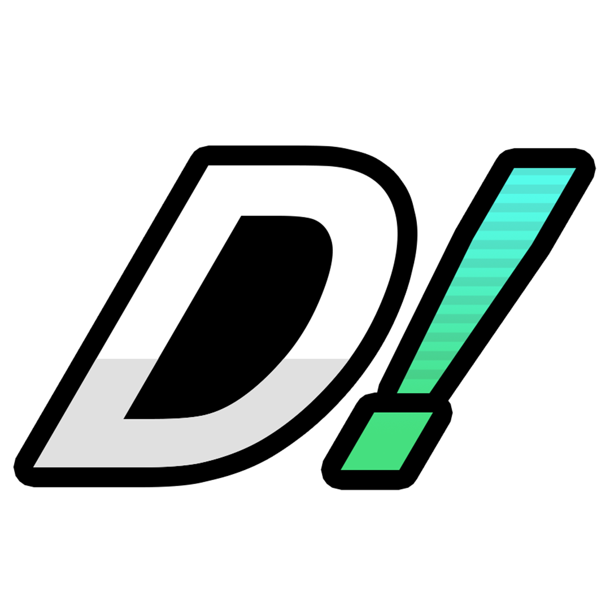

# P+ Dojo!
<p align="center">
  
[Check Website](https://pplus-dojo.pages.dev/)
  
</p>

## What is P+ Dojo?

It's a resource hub to check and learn all about Project+ frame data and hitboxes. The sections made so far includes:
- All the frame data and a 3D viewer for all the animations and hitboxes.
- Interactive charts comparing the stats of all the fighters.
- Stage viewer for comparing each stage size and layout (work in progress).
- Study section with a spaced repetition algorithm, similar to Anki, where you can learn and be tested on everything on the site.
- A compendium where you can see what you've learned so far and what's left. With optional save on the cloud.

## Why?

I originally wanted to study frame data using Anki, but then I realized that, thanks to all the amazing tools and spreadsheets the community has created for this game, I could put together a package that makes everything easy to access and study!

I wanted to share it so everyone could benefit from it!

I'd really appreciate any feedback! And remember, this is still a work in progress, so there might be some errors or missing information. Any help is more than welcome!

## How does it work?

React/TypeScript frontend, Three.js collision viewer, optional Firebase account sync, and an Electron
Windows app.

- [Website](https://pplus-dojo.pages.dev/)
- [Windows downloads](https://github.com/Dulop57/pplus-dojo-releases/releases)
- [Source](https://github.com/Dulop57/PPlus-Dojo)

## Develop locally

Use Node.js 22 or a compatible supported version, plus npm.

```sh
npm ci
npm run study:select
npm run study:build
npm run dev
```

Open the localhost URL printed by Vite. A fresh checkout includes workbook
references, study cards, and a synthetic viewer sandbox. Full fighter animations
require a separately extracted game dataset. Generated data, raw game inputs,
owner configuration, and local build outputs are excluded from this repository.

Accounts are optional. For your own services, copy
`desktop.config.example.json` to `desktop.config.json` and configure your own
Firebase project with Email/Password authentication and Firestore. Use
`firebase/firestore.rules` to restrict records to their owner. Never commit
passwords, tokens, or service-account keys, or use production player accounts
for development tests. Browser Firebase configuration is public client data.

## Game data and study selection

Extraction requires stable Rust, a Brawl source folder containing
`fighter/Fighter.pac`, and the full Project+ v3.2 SD-card directory. Windows Rust
builds also need a compatible C++ toolchain. Use your own game inputs and keep
them outside the source repository.

```sh
cargo run --release -p dojo-exporter -- --brawl "C:/Games/Brawl-files" --pplus "C:/Games/PPlus-SD" --out public/data --fighters marth,mario,fox,knuckles
npm run study:select
npm run study:build
npm run validate:data
```

The extracted game statistics and collision geometry remain **unverified**.
Builds and tests do not establish game accuracy; upstream and in-game comparisons
are still needed. Preserve the data-status and workbook-version notices.

[FLASHCARD-STATS.md](FLASHCARD-STATS.md) controls which stats generate cards.
Preserve existing card/stat IDs and labels: progress uses those IDs. Unchanged
answers retain schedules, changed answers refresh existing cards, and removed
cards retain saved history. Offline study, separate guest/account databases,
durable sync queues, and the per-device RAM preload setting (off by default)
must remain compatible across updates.

## Test and build

```sh
npm test
npm run desktop:test
npm run test:browser
npm run build
```

Run the study preparation above before browser tests. Windows browser tests use
installed Microsoft Edge; Linux uses Playwright Chromium
(`npx playwright install --with-deps chromium`). Rust tests use
`cargo test --workspace --locked`. Live Firebase tests require deliberate opt-in
and create external accounts/records; do not run them as routine unit checks.

`npm run build` regenerates study content and creates `dist`. After UI-only
changes, `npm run build:ui` can reuse an already prepared `dist/data` and the
existing study catalog. It does not regenerate study content.

For a standalone Windows preview with a prepared dataset:

```sh
npm run desktop:start
npm run desktop:package -- --preview
npm run desktop:verify-release
```

For your own browser hosting, configure Firebase in `desktop.config.json`,
prepare `dist/data` and `dist/study`, then run `npm run web:build` and
`npm run web:preview`. `npm run web:package` creates the upload ZIP. The web
service worker must precache `/`, because redirected `/index.html` responses
break offline navigation on Cloudflare Pages.

The existing website uses Cloudflare Pages Direct Upload. Windows releases use
a separate release-only repository; publishing source does not update either
product. Generated outputs stay local. Legacy Rust browser-launcher packaging
also remains available through `package:windows`; Electron is the active
standalone Windows app.

## Source exports and contributions

Keep changes focused and run the checks relevant to them. Preserve local study
history and owner-only access rules. Include both web and Windows content updates
when publishing flashcard changes.

`npm run package:source` exports the **committed** Git snapshot to
`artifacts/PPlus-Dojo-Source.zip`, excluding untracked/ignored owner files. Commit
reviewed changes before exporting; the helper rejects tracked local-only paths.

## License and attribution

Application code is under the [MIT license](LICENSE). Preserve
[third-party notices](THIRD-PARTY-NOTICES.md) and vendored dependency licenses.
Extraction follows [Rukaidata](https://github.com/rukai/rukaidata) and
[brawllib_rs](https://github.com/rukai/brawllib_rs) by Lucas Kent (Rukai).

Fighter portraits, stock icons, and stage images were sourced from the
[Dragdown P+ Wiki](https://dragdown.wiki/wiki/PPlus). The wiki file pages provide
source histories and copyright notes, but their text license does not establish
reuse rights for game images. Those permissions and individual artist credits
have not been verified. The MIT license applies to application code, not this
artwork or Project+ branding. See [third-party notices](THIRD-PARTY-NOTICES.md)
and [the retained logo credits](Images/project-plus-assets-master/logos/credits.md).
